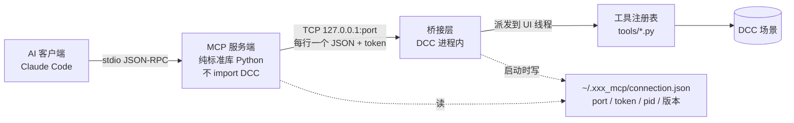

# DCC MCP 桥接架构

[[gaffer_mcp]]、[[houdini_mcp]]、[[nuke_mcp]] 三个包用同一套结构，让 AI 客户端经 [[Model Context Protocol]] 驱动一个正在运行的 DCC。houdini_mcp 和 nuke_mcp 都照搬 gaffer_mcp（[[来源 - Claude 全局记忆]]）。

## 两个进程、一条 TCP

- **服务端**（`server/*.py`）：纯标准库，**不 import 任何 DCC 模块**，用独立的 Python 3.11 跑。它只做协议转换和工具列表缓存。
- **桥接层**（`python/*_gui.py` 一类）：随 DCC 启动自动拉起，监听 `127.0.0.1:<port>`，每次工具调用一条新 TCP 连接，请求 `{id, token, op, params}`、响应 `{id, ok, result|error}`。只管传输、UI 线程派发、查注册表。
- **连接发现**：桥接层启动时写 `connection.json`（端口、本次启动新生成的 token、pid、DCC 版本），服务端读它连过去。

| 包 | 默认端口 | 状态目录 | 端口环境变量 |
|---|---|---|---|
| [[gaffer_mcp]] | 24745 | `~/.gaffer_mcp` | `GAFFER_MCP_PORT` |
| [[houdini_mcp]] | 24746 | `~/.houdini_mcp` | — |
| [[nuke_mcp]] | 24747 | `~/.nuke_mcp` | — |

## 工具清单不写死

- 服务端没有静态工具表。`tools/list` 时向桥接层发内部 op `__list_tools` 要，结果缓存到状态目录的 `tools_cache.json`；DCC 没开时退回包内的 `tools_seed.json`（`--dump-tools` 刷新）。
- `initialize` 声明 `tools.listChanged`；每次 `tools/call` 后按 10 秒节流复查一次，工具集变了发 `notifications/tools/list_changed`。
- 服务端**不做参数 schema 校验**：缓存可能过期，挡掉的会是合法调用。未知工具名一律转发给桥接层裁决。

## 一个工具 = 一个文件

- 工具作者 API：`@tool(name, description, params, undo, dirty, ...)` 把 schema 和实现写在一处；参数用 `P.str/int/float/bool/enum/list/dict/any` 声明；统一校验必填、类型、枚举、范围、未知参数，函数拿到的是已经转换好的关键字参数。
- 查找顺序：包内 `tools/*.py` → 环境变量指定的目录（冒号分隔）→ 状态目录下的 `tools/*.py`（个人工具）。**后加载的同名工具覆盖前面的**；`_` 或 `.` 开头的文件跳过。
- 热加载：按文件 mtime + 大小做指纹，下一次 MCP 调用时发现变化就重载，再通知客户端刷新。**存盘即生效，不改服务端、不重启 DCC**。
- 加载工具文件用 `compile()` + `exec()` 进模块字典，不走 `spec.loader.exec_module`：后者的字节码缓存只看 mtime 的秒数和文件大小，同一秒内改成同样大小会静默加载旧字节码。见 [[Python 热加载读到旧字节码]]。
- 单个文件加载失败只记进 `loadErrors`，其余工具照常可用。
- 热加载只覆盖工具文件；改了包内 `python/` 下的模块要重启 DCC。

## 撤销与线程

- 声明 `undo=True` 的工具由派发层包进一个撤销组（Gaffer 是 `Gaffer.UndoScope`），一次 MCP 调用 = 一步 Ctrl+Z。
- 工具在 DCC 的 UI 线程执行（Gaffer 用 `EventLoop.executeOnUIThread`，Houdini 用 `hdefereval`）。派发进 UI 线程的函数抛异常会被 Qt 吞掉，所以派发层统一 try/except，把错误转成返回值。
- 没有 UI 的环境（Houdini 的 hython、Nuke 的 `-t`）要有「直接调用」分支，这样无头测试能覆盖全部工具。

## 各 DCC 的差异

- **Gaffer**：改完图后读计算结果要等脏传播结束；`dirty=True` 的工具自动把脚本标成未保存；有多个打开的脚本，要「选当前脚本」的工具。
- **Houdini**：按需 cook，撤销组里改完参数立刻读几何拿到的就是新值；改动状态直接问 `hou.hipFile.hasUnsavedChanges()`；一个进程一个 hip，节点一律按路径寻址。见 [[houdini_mcp]]。
- **Nuke**：一个包通吃所有版本——启动钩子是 `NUKE_PATH` 上的 `init.py`（所有模式只加 `sys.path`）和 `menu.py`（只在 GUI 拉起桥接层）。同时开两个 Nuke 时，后启动的那个换随机端口并覆盖 `connection.json`，MCP 连到最后启动的那个。见 [[nuke_mcp]]。
- **Unreal Engine**：用官方 [[UE ModelContextProtocol 插件]]，HTTP 传输，只暴露 3 个元工具，和这套结构无关。

## 测试分三层

1. **无头**：在 DCC 的无界面 Python 里直接调注册表和每个工具（Gaffer `bin/gaffer env python`、Houdini `hython`、Nuke `-t`）。
2. **协议**：纯标准库客户端 + 假桥接层，验证 stdio 协议、缓存、`list_changed` 通知，不需要 DCC。假桥接层是明确设计的测试边界。
3. **真机**：起 GUI，连真实桥接层建图；运行中往个人工具目录丢一个新文件，确认立刻可用。

## 相关

- 实体：[[Model Context Protocol]] —— 底层协议
- 实体：[[gaffer_mcp]] —— 这套结构的原型
- 实体：[[houdini_mcp]] —— 照搬到 Houdini
- 实体：[[nuke_mcp]] —— 照搬到 Nuke，一包通吃所有版本
- 实体：[[UE ModelContextProtocol 插件]] —— UE 用官方实现，结构不同
- 问题：[[MCP 工具在会话中途启动 DCC 后接不上]] —— 三个服务端共有的启动顺序问题
- 问题：[[Python 热加载读到旧字节码]] —— 工具文件用 compile + exec 加载的原因
- 问题：[[contextmanager 里 yield 包 try 报 didn't stop after throw]] —— 写撤销组上下文管理器时的坑
- 来源：[[来源 - Claude 全局记忆]]
