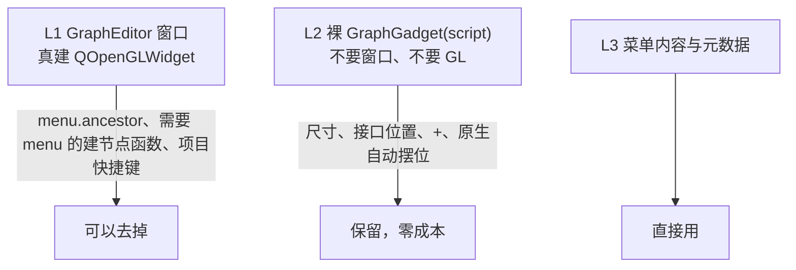

# 在 Gaffer 里另做 Qt 节点图编辑器

[[gaffer_network_editor]] 的设计总结：为什么另做、和原生怎么共存、哪些东西必须问原生要、哪些机制会咬人。具体的 Qt 问题见 [[Qt 自绘界面常见坑]]，自动排列见 [[节点图自动排列算法对比]]。

## 为什么另做一个视图

原生 [[Gaffer GraphEditor]] 是 OpenGL + 写死的 GLSL shader，`Style`、`GraphGadget`、`GraphLayout` 都不能 Python 子类化，能改的只有 5 个节点元数据和 8 个全局颜色。要渐变、阴影、矢量图标、任意字号，只能另起一个 [[Qt]] QGraphicsView。参数面板正好相反：[[Gaffer NodeEditor]] 是纯 Python + Qt，能在原生基础上改（见 [[gaffer_parameter_editor]]）。

## 和原生共存

两个编辑器可以同时开、互相同步，因为所有状态都存在节点图里，两边读写同一份：

| 东西 | 存在哪 |
| --- | --- |
| 节点位置 | `node["__uiPosition"]`（节点中心点，Gaffer y 向上） |
| 连线折叠 | `__uiInputConnectionsMinimised` / `__uiOutputConnectionsMinimised` |
| Backdrop 框 | `node["__uiBound"]` |
| 选择 | `script.selection()` |
| focus | `script.getFocus()` / `focusChangedSignal()` |
| 书签、注释、只读 | `Gaffer.MetadataAlgo` |
| 形状、颜色、图标、Show Name | 节点元数据，要连 `Gaffer.Metadata.nodeValueChangedSignal(node)` |

## 几何、配色、行为都问原生要

自己发明的尺寸和配色一定对不上，原则是「能问原生就问原生」：

- 节点尺寸：`nodeGadget.bound()`（只当下限，字体不同会截字）。
- 接口位置和切线：nodule gadget 的 `transformedBound()` / `connectionTangent()`；展开的 Color3f 子圆点照原生 `CompoundNumericNodule`（0.75 倍缩放、一格一簇）。拿原生 gadget 量之前先 `nodeGadget.bound()` 一下，里面的 `LinearContainer` 是懒排版，不问尺寸拿到的是未排版的坐标。
- 接口颜色：插口类型注册的 `nodule:color`；节点颜色 `nodeGadget:color`；连线默认色用原生 StandardStyle 的颜色，不读插口上的 `connectionGadget:color`（会读到别的扩展注册的配色）。
- `+`（PlugAdder）可见性分两层：节点级（setup 过就藏，Box 永远有）+ 插口级（NameSwitch / Collect 的 `in` 上那个一直可见，材质 `parameters` 下有藏着的可显示插口时才出现）。
- 菜单措辞照抄原生（`/Focus`、`/Enabled`、`/Bookmarked`、`/Show Contents...`、`/Copy`、`/Cut`、`/Delete`），自拼的那半和借来的那半才不串。
- 手势照原生源码逐条抄：拖起连线端点改接（`StandardConnectionGadget.endAt`）、把节点插进连线（`GraphGadget::updateDragReconnectCandidate`）、拖到视口边缘自动滚（`ViewportGadget::trackDrag`）、Alt+右键缩放（`ViewportGadget.cpp` 的 Dolly）。
- 节点停用状态：`enabled` 不能直接 `getValue()`，那是一次计算，图里有依赖环时会刷一屏 "Cycle detected"；照原生用 `Gaffer.PlugAlgo.dependsOnCompute` 判断是不是静态值，拿不准就画第三种状态。
- focus 显示靠 [[Gaffer ContextTracker]]，自己 BFS 算出来的集合一定和原生不一致。

## 不建原生 GraphEditor 窗口

原生的右键菜单、NodeMenu、项目快捷键都假设有一个 GraphEditor。依赖分三层：

去掉 L1 的做法（四步都已实现）：

1. **接管类**：`GafferUI.GraphEditor` 换成元类壳，`isinstance(ourEditor, GafferUI.GraphEditor)` 为 True，类属性转发给原生，`acquire` 落到自己。做法见 [[替换 Gaffer 原生编辑器的方法]]。
2. **提供原生要的 API**：`graphGadget()`（自己的裸 GraphGadget，连 `rootChangedSignal`，项目快捷键 `setRoot()` 换层时视图跟着变）、`graphGadgetWidget()`（只实现 `getViewportGadget()` / `bound()` / `size()` / `_qtWidget()` 的壳，故意不做成 `GafferUI.Widget`，那会登记全局 owner 表）、`frame()`、`scriptNode()`、右键菜单四个信号。`bound()` 和取景都按整个编辑器（含工具条）算，原生粘贴用 `graphEditor.bound()` 算 raster。
3. **同步取景**：每次被调用时让一个独立 [[ViewportGadget]] `setViewport(视口像素)` + `frame(当前可见 scene 矩形换算成 Gaffer 单位，y 翻转)`，往返误差约 0.25px。一个 gadget 只能有一个父，挂给第二个 ViewportGadget 会被抢走，所以不挂借来的 gadget；`rasterToGadgetSpace(gadget=X)` 对不在树里的 X 结果一样。
4. **菜单宿主和快捷键**：借来的原生菜单把 `_Menu__popupParent` 设成 `weakref.ref(self)`；接管装着时主动发 `GafferUI.GraphEditor.instanceCreatedSignal()(self)`，项目快捷键处理函数直接连自己的 `keyPressSignal`。

NodeMenu 里有几个节点（Box、Backdrop、Reference、图像滤波）的创建函数自己要 `menu` 参数。建节点面板现造一个不弹出的 `GafferUI.Menu`，把 `_Menu__popupParent` 指到宿主上来调用。原生包装最后会调 `frame()`，临时换成空函数，免得视野被拽走；摆位不包 `UndoScope`（原生也在外面），否则建一个节点要撤销两次。判断「命令要不要 menu」看函数签名，Backdrop 是 `definition().append()` 挂的裸函数。

另加了一个 `__getattr__` 诊断钩子，记录「原生要过但自己没有」的属性，用来发现漏掉的 API。

## 增量更新

全量重建 63% 的时间花在逐个建 item（每个都要问原生 gadget 尺寸和接口），800 节点 240ms。按名字 diff 之后约 5ms，和图的大小无关：

| 信号 | 处理 |
| --- | --- |
| root 的 `childAdded/Removed` | 节点集合变了，diff 节点 + 边 |
| `nameChanged` | 那一个 item 重建 |
| `plugInputChanged`（报的是目的地节点） | 只重收以它为终点的边；接一根 ScenePlug 的线这个信号沿下游响约 87 次，先比 key 再动 item |
| 节点的 `childAdded/Removed` | 插口结构变了，只连可能长子插口的（ArrayPlug、CompoundDataPlug、TweaksPlug、裸 Plug 容器） |
| 元数据、`enabled` | 那个 item 重建 |
| `__uiPosition` | 只挪位置，按节点名记脏 |

要点：

- 插口身份用节点内相对名（见 [[Gaffer NameSwitch 第二路连线不显示]]）；节点身份用 `isSame()`，名字会变、Python 包装对象每次都是新的（见 [[Boost.Python 包装对象身份]]）。结构变化后按 `isSame` 给 item 换绑节点（Revert 后同名但不同节点）。
- 只改线时一次全图都不扫；`setSceneRect` 会让整个视口失效，没变就不设。
- 动 item 期间 `scene.blockSignals`，否则删掉选中 item 发的 `selectionChanged` 会被写回 script。
- 靠「连没连」改变外观的东西（侧边参数名加粗）不会跟着增量更新刷新，要单独刷，并且对线的两头都刷。
- 重建放进 idle 回调。原生 `__preRender` 写 `__uiPosition` → `childAdded` → 同步重建会形成死循环（见 [[Gaffer 自制 Editor 同步重建界面导致卡死]]）。
- 拖动期间绝不重建：重建删掉 item，Qt 的隐式鼠标抓取跟着丢，这一下拖动静默失效。判断要同时看模式标记和 `QApplication.mouseButtons()`。
- 计算线程发来的 `errorSignal` 先 `executeOnUIThread` 再处理。

## 拖放

GafferUI 的拖放自己按鼠标位置找控件发 `dragEnterSignal` / `dragMoveSignal` / `dragLeaveSignal` / `dropSignal`，自建编辑器不接这四个就毫无反应。落在节点上的拖放直接转发给原生 NodeGadget 的信号（PathFilterUI / SetFilterUI 早挂在 `NodeGadget.instanceCreatedSignal` 上）；单条路径落在空白处是跳到生成它的节点。`Pointer.getCurrent()` 平时就是 None，不能用来判断是否在拖；`event.line` 是控件像素坐标。

中键拖节点发给别的编辑器：起拖不走 `buttonPressSignal`（返回 True 会吃掉 Qt 事件）；GafferUI 的全局事件过滤器要自己补装到 QGraphicsView 和 viewport 上。

## 换层与视野

换层前按节点对象（`isSame()`）记下当前可见矩形，到新层先查有没有记过，照原生 `_HistoryWidget` 的做法；无脑 `frameAll()` 会让「放大看 Box → 进去 → 出来」变成全景。右键 `Show Contents...` 进 Box 时，新建节点的摆位要带上当前 root，否则 Box 里没连线的节点被搬到菜单位置。

## 验证方法

- 四套测试：无头、screengrab 出图、真键盘真鼠标（xdotool）、接管专项。真鼠标才测得出的东西很多：item flag（`ItemIsMovable`）、嵌套 popup、滚轮、Alt+右键（窗口管理器可能抢走）、按住 X 的按键自动重复。
- 和原生对拍：同一个 root 各建一个自己的编辑器和真正的原生 GraphEditor，比较每个接口在哪条边排第几、每条连线两头的插口相对名、节点尺寸。原生 GL 视图的 `grab()` 是黑图，只能比数据。
- 新断言先在「还原了改动的整包副本」上跑，确认会挂。
- 跑完才写报告的脚本，跑前先删旧报告；条数没变多半是中途抛异常。
- 方法论技能：`~/.claude/skills/gaffer-qt-network-editor/`；测试环境和截图通用做法见 [[Gaffer 无头测试与截图验证方法]]。

## 相关

- 实体：[[gaffer_network_editor]] —— 按这套设计实现的编辑器
- 实体：[[Gaffer GraphEditor]] —— 被替代的原生编辑器
- 实体：[[Qt]] —— 视图层
- 实体：[[Gaffer NodeEditor]] —— 对照：参数面板可以在原生基础上改
- 实体：[[gaffer_parameter_editor]] —— 对照：另一个自制编辑器
- 概念：[[Gaffer ContextTracker]] —— focus 显示的依据
- 概念：[[ViewportGadget]] —— 不建窗口时同步取景
- 概念：[[Houdini rounded 连线]] —— 连线画法
- 概念：[[Boost.Python 包装对象身份]] —— 节点身份用 `isSame()`
- 问题：[[Gaffer NameSwitch 第二路连线不显示]] —— 插口身份要用相对名
- 问题：[[自制节点图编辑器在 Gaffer 1.7 下建不出来]] —— 接管后要补齐原生接口
- 问题：[[Gaffer 自制 Editor 同步重建界面导致卡死]] —— 重建要放到 idle
- 综述：[[Qt 自绘界面常见坑]] —— Qt 层面的问题汇总
- 综述：[[节点图自动排列算法对比]] —— 自动排列
- 综述：[[替换 Gaffer 原生编辑器的方法]] —— 接管原生类的通用做法
- 综述：[[Gaffer 无头测试与截图验证方法]] —— 测试与出图
- 来源：[[来源 - Claude 全局记忆]]
